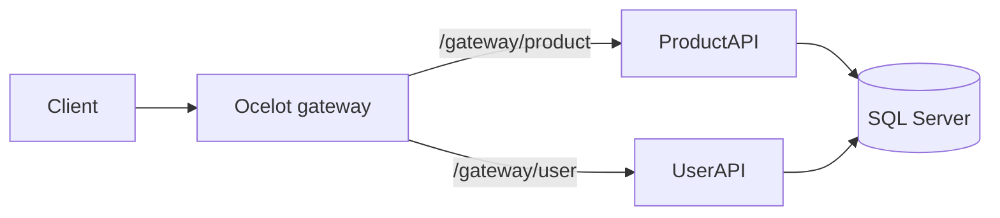

# Ocelot API Gateway Example

A learning project demonstrating a single gateway entry point for two ASP.NET Core APIs: products and users. It makes the routing boundary between a client and downstream services visible in a small solution.

**Status:** legacy .NET 7 practice sample. It is not a hardened production gateway.

## What the code demonstrates

- Ocelot routes defined in `OcelotAPIGateway/ocelot.json`.
- Separate `ProductAPI` and `UserAPI` applications with CRUD controllers.
- Service interfaces and implementations backed by EF Core and SQL Server.
- Swagger in development for each application.



## Project structure and stack

```text
OcelotGatewayExample.sln
├── OcelotAPIGateway/  # Ocelot 19.0.2, routing configuration
├── ProductAPI/        # Product CRUD, EF Core 7.0.9, migrations
└── UserAPI/           # User CRUD, EF Core, migrations
```

All three projects target `net7.0`. This is a historical sample; the target framework is out of support. Framework/package modernization is separate from this documentation update.

## Prerequisites

- An SDK capable of building .NET 7 projects, and the ASP.NET Core 7 runtime to run them.
- A local SQL Server instance and permission to create development databases.
- A trusted localhost development certificate for the HTTPS downstream routes.
- For database initialization: EF Core tooling compatible with EF Core 7.

## Restore and build

From the repository root:

```powershell
dotnet restore OcelotGatewayExample.sln --source https://api.nuget.org/v3/index.json
dotnet build OcelotGatewayExample.sln --no-restore
```

The explicit NuGet source avoids unrelated private feeds configured on a developer's machine.

## Local configuration and database setup

Both APIs read `ConnectionStrings:DefaultConnection`. Override the checked-in machine-specific values in each terminal before running database commands or the API:

```powershell
$env:ConnectionStrings__DefaultConnection = 'Server=localhost;Database=GatewayProductsDemo;Trusted_Connection=True;TrustServerCertificate=True'
```

For UserAPI use a separate development database, such as `GatewayUsersDemo`. Adjust the server and authentication for your local environment; do not commit passwords. `TrustServerCertificate=True` in this example is for local development.

If EF tooling is not already installed, a repo-local tool can be prepared on your machine:

```powershell
dotnet new tool-manifest
dotnet tool install dotnet-ef --version 7.0.9 --add-source https://api.nuget.org/v3/index.json
dotnet ef database update --project ProductAPI/ProductAPI.csproj
```

Then change the environment variable to the users database and apply its migrations:

```powershell
$env:ConnectionStrings__DefaultConnection = 'Server=localhost;Database=GatewayUsersDemo;Trusted_Connection=True;TrustServerCertificate=True'
dotnet ef database update --project UserAPI/UserAPI.csproj
```

These setup instructions derive from the committed DbContext configuration and migrations. Database initialization was not executed during the documentation review.

## Run the three applications

Use three terminals from the repository root. Set each API's connection-string environment variable in its own terminal first.

```powershell
# Terminal 1: ProductAPI HTTPS port matches ocelot.json
dotnet run --project ProductAPI/ProductAPI.csproj --launch-profile https

# Terminal 2: UserAPI HTTPS port matches ocelot.json
dotnet run --project UserAPI/UserAPI.csproj --launch-profile https

# Terminal 3: Explicit gateway port matches GlobalConfiguration.BaseUrl
dotnet run --project OcelotAPIGateway/OcelotAPIGateway.csproj --no-launch-profile -- --urls https://localhost:7283
```

The gateway's checked-in HTTPS launch profile uses port **7088**, while `GlobalConfiguration.BaseUrl` says **7283**. The explicit command above avoids that mismatch without changing application files. Downstream ports are **7117** for products and **7200** for users.

With databases and services ready, try:

```powershell
Invoke-RestMethod https://localhost:7283/gateway/product
Invoke-RestMethod https://localhost:7283/gateway/user
```

| Gateway path | Downstream path | Methods |
|---|---|---|
| `/gateway/product` | `/api/product` | GET, POST, PUT |
| `/gateway/product/{id}` | `/api/product/{id}` | GET, DELETE |
| `/gateway/user` | `/api/user` | GET, POST, PUT |
| `/gateway/user/{id}` | `/api/user/{id}` | GET, DELETE |

## Known limitations

- Broad credentialed CORS is configured; no gateway authentication/rate-limiting policy is demonstrated.
- CRUD paths have minimal error handling, including missing-record cases.
- SQL Server is required; no database, container orchestration, or end-to-end test environment is provisioned automatically.
- No hosted demo or screenshot is claimed.
- No root project license was found; this update does not add or infer one.

## Verification

Documentation review on 2026-10-27: restore and build succeeded using .NET SDK 10.0.402, with **15 warnings and 0 errors**. Warnings include the legacy target framework and nullable-reference issues. HTTP and database flows were not run; no database was created or migrated.
